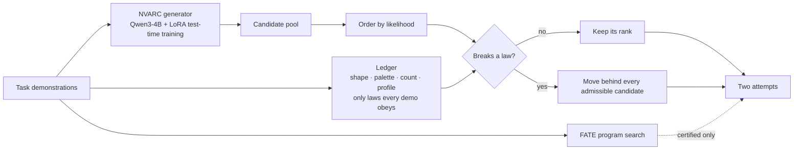

<p align="center">
  
</p>

<p align="center">
  <a href="https://www.kaggle.com/competitions/arc-prize-2026-arc-agi-2"></a>
  <a href="https://www.kaggle.com/code/netphantom17/fate-ssm-final?scriptVersionId=362418669"></a>
  <a href="https://www.kaggle.com/code/netphantom17/fate-ssm-final?scriptVersionId=362418669"></a>
</p>
<p align="center">
  <a href="https://doi.org/10.5281/zenodo.24093939"></a>
  <a href="PREREG.md"></a>
  
  <a href="LICENSE"></a>
  <a href="https://www.kaggle.com/code/netphantom17/fate-ssm-final"></a>
</p>

<h3 align="center">A model can tell you what is likely. It cannot tell you what is allowed.<br>FATE keeps those two jobs apart. That is the whole idea, and it is mine.</h3>

---

## At a glance

| | |
|---|---|
| **The rule** | Likelihood may **order** the candidates. Only a law of the task may **demote** one. Nothing is ever deleted. |
| **Generator** | The open NVARC pipeline: Qwen3-4B (4 billion parameters), per-task LoRA test-time training, DFS decoding. Used unmodified. Not mine. |
| **My layer** | FATE: a demonstration ledger and a certified program search. 720 lines of Python with tests, shipped as one 15.5 KB file. CPU only. No training, no weights. |
| **Score** | **28.06** on the Kaggle ARC-AGI-2 leaderboard (submission 57677356, notebook Version 1, the run analysed below). A later rerun of identical code, 57913192, scored 29.72. |
| **Safety** | The ledger excluded the truth on 2 of 172 outputs, at no cost: the truth was not generated there. |

## Why it works

**1. Every answer has two properties, and a language model only sees one.**
How probable an answer is, and whether the task allows it. A model trained on grids gets very good at the first. It has no built-in handle on the second. ARC tasks hide hard laws in their demonstrations: what shape the output takes, which colours may appear, how many cells of each colour come through. Those are not preferences. An answer that breaks one is wrong no matter how confident the model is about it.

**2. The ledger only believes a law that every demonstration obeys.**
It checks four: the shape rule (same as the input, or transposed), the palette (which colours an output may introduce), the exact colour count, and the sorted colour profile. A law enters the ledger only if it holds on every single demonstration pair. So a demotion can only cost me if the hidden answer breaks a law that every example obeyed. That is the one way this layer can fail. It is checkable, and I checked it: on the official run the ledger excluded the truth on 2 of 172 outputs, and neither cost anything, because the model had not generated the truth there.

**3. Demote, don't delete.**
A candidate that breaks the ledger moves behind every candidate that keeps it. It stays in the pool. If fewer than two candidates are admissible, the model's own order fills both attempts. The worst case is bounded by construction: the layer can only lose to the baseline on a false exclusion, and I pre-registered that prediction before reading a single result.

**4. Deleting by likelihood cost answers here.**
I ran the tempting alternative as a control (V4): throw out anything the model finds too unlikely. On the official run it lost two correct answers the baseline had, both in second place. My layer won one the baseline missed. Neither difference is significant (sign test p = 0.5 and 1.0). Unlikely is not impossible. That one sentence is the theory, and here it is in a leaderboard pipeline.

**5. Certify, or stay out of the way.**
FATE also searches for an exact program, meeting in the middle at depth 2 from each side plus a colour map, and trusts one only if it reproduces every demonstration exactly. On the 1,000 training tasks, 15 certify and 14 of those are right. On the 120 evaluation tasks, none certify. So the submitted variant uses the ledger, not the program search. I report the search anyway, because a certificate that stays silent when it has nothing is the point.

## How it fits together



## The receipts

Every variant was fixed in [`PREREG.md`](PREREG.md) before any pool or precision number was read. These are recorded NVARC candidate pools on public evaluation tasks, scored against the public answers. The official run is the linked submission's own commit run (notebook Version 1, all 120 tasks); its full log and per-output analysis are in [`receipts/official_v1`](receipts/official_v1). The earlier rows are smaller runs made before it.

| Run | Tasks | Test outputs | Truth anywhere in pool | Truth admitted by ledger | V0 baseline | **V1 (submitted)** | V4 delete-by-likelihood |
|---|---:|---:|---:|---:|---:|---:|---:|
| **official (Version 1)** | 120 | 172, 157 with a pool | 34.4% | 156 / 157 | 43 | **44** | 41 |
| pilot | 8 | 10 | 30.0% | 10 / 10 | 3 | **3** | 3 |
| partial | 67 | 93 | 34.4% | 93 / 93 | 27 | **28** | 26 |
| commit subset | 18 | 28 | 17.9% | 28 / 28 | 3 | **3** | 3 |

On the official run, V1 against V0 is 1 win and 0 losses; V4 against V0 is 0 wins and 2 losses. Neither is significant (sign test p = 1.0 and 0.5). The full account is the paper-track submission: [Safe, Narrow, and Below the Noise Floor](https://www.kaggle.com/competitions/arc-prize-2026-paper-track/writeups/safe-narrow-and-below-the-noise-floor).

The column that matters most is "truth anywhere in pool". Selection can only pick what the generator produced. Pool recall is the ceiling, and it is far above what any selection rule moves. I predicted that too (P7). FATE is a guarantee about what it will never throw away, not a trick that invents answers.

## The theory behind it

This is the applied side of my paper, [*Likely and Allowed: The Joint State of Prediction and Admissibility*](https://ivybe1337.github.io/Survival-Mechanics/) ([DOI 10.5281/zenodo.24093939](https://doi.org/10.5281/zenodo.24093939)). Its headline result: a forecaster that ignores which futures a rule still allows can be forced to be wrong by nearly as much as any forecaster can, with error approaching 1 − 1/d on a d-symbol alphabet. The fix is to carry two states, one for what is likely and one for what is allowed. In FATE the model is the first, the ledger is the second, and neither is allowed to do the other's job.

<details>
<summary><b>Notebook terms → paper terms</b></summary>

| Notebook | Paper |
|---|---|
| Survival State Mechanics (SSM) | the joint state of prediction and admissibility |
| survival state κ | residual state κ |
| survival semantics; the demonstration ledger | admissibility rule V |
| model score, candidate likelihood | predictive state ε and its forecast |
| SSM mask (V1) | ordering by ε, demotion by V |
| FATE-certified program (V2) | certified admissible, status A |
| nogood, certified elimination | certified exclusion, status X |

</details>

<details>
<summary><b>The five pre-registered variants</b></summary>

| Variant | Rule |
|---|---|
| V0 | the pipeline's own score, unchanged |
| V1 | V0 order, ledger-inadmissible candidates demoted (submitted) |
| V2 | a FATE-certified program, when one exists, fills attempt 1 |
| V3 | V2 and V1 together |
| V4 | control: delete by likelihood threshold, which my rule forbids |

</details>

<details>
<summary><b>Repository layout</b></summary>

```
notebook/                 Version 1 (submission 57677356, the analysed run), Version 3 (the identical-code rerun 57913192), metadata
fate_ssm/
  ledger.py               the demonstration ledger
  select_pool.py          variants V0 to V4 over a candidate pool
  fate_arc.py             FATE program search on ARC grids
  fate_engine.py          the meet-in-the-middle engine
  local_rule.py           local cell rules (offline study)
  entry.py                notebook entry points
  tests_fate.py           FATE tests
  tests_select.py         selection tests
build_runtime.py          packs fate_ssm into one file
fate_ssm_runtime.py       the single file the notebook writes to disk
make_final_kernel.py      builds the notebook from the NVARC baseline
eval_pools.py             offline comparison of the variants
fate_precision.py         precision of certified programs
local_rule_stats.py       coverage and precision of local rules
receipts/                 precision and local-rule results
PREREG.md                 the pre-registration
```

</details>

## Run it

```bash
pip install numpy scipy
python -m fate_ssm.tests_fate
python -m fate_ssm.tests_select
export ARC_DATA=/path/to/arc-prize-2026-arc-agi-2
python fate_precision.py
```

`ARC_DATA` holds the competition's `arc-agi_*_challenges.json` and `arc-agi_*_solutions.json`. The full generator needs a GPU and runs on Kaggle; the notebook is the reference build.

## Cite

```bibtex
@software{carter_fate_2026,
  author = {Carter, Joshua Matthew},
  title  = {FATE: admissibility selection for ARC-AGI-2},
  year   = {2026},
  url    = {https://github.com/ivybe1337/FATE-ARC-AGI-2}
}
@misc{carter_likely_allowed_2026,
  author = {Carter, Joshua Matthew},
  title  = {Likely and Allowed: The Joint State of Prediction and Admissibility},
  year   = {2026},
  doi    = {10.5281/zenodo.24093939}
}
```

## License

Everything I wrote here, code, text, method and figures, is licensed under [Creative Commons Attribution 4.0 International (CC BY 4.0)](LICENSE), the license my ARC Prize 2026 submission states and the competition rules require.

- **Commercial use:** allowed.
- **Credit:** required. Name *Joshua Matthew Carter (iVybe), "FATE: admissibility selection for ARC-AGI-2", ARC Prize 2026*, link this repository, and say what you changed.

The NVARC pipeline cells in the notebook and `sorokin/pip-install-unsloth-flash-patch` belong to their authors and stay under their terms.

<p align="center"><sub>Joshua Matthew Carter · iVybe</sub></p>
